# 바통 (Baton)

간호사의 반복 기록과 인계를 줄이는 모바일 웹앱

<p align="center">
  
</p>

### 해결하려는 문제

- 같은 정보를 처방노트·환자 메모·인계 메모에 반복하여 작성하는 구조
- 근무 교대마다 인계 내용을 다시 받아 적어야 하는 부담
- 기존 음성 기록 솔루션은 대형병원 중심으로 공급되어 중소병원에서 활용하기 어려움

## 핵심 흐름

간호사 한 명이 자기 폰에서 근무 하나를 처음부터 끝까지 쓰는 구조입니다. 다른 기기와 주고받지 않습니다.


| 탭 | 설명 |
|---|---|
| 할 일 | 근무를 시작하면(듀티는 캘린더에서 자동 선택) 담당 환자별 인계 메모를 적습니다. `리스트 만들기`를 누르면 시간 표현과 처치어는 시간 할 일로, NPO·낙상·알레르기·격리는 경고 칩으로 바뀝니다. 규칙으로 못 푼 조각만 AI가 정리하고, 확신하지 못한 항목에는 `확인 필요`가 붙습니다. |
| 기록 | 담당 환자를 고르고 키워드 칩과 약어 자동완성으로 입력하면 간호기록체 초안이 나옵니다. 확인하면 확정되고, 확정한 기록만 복사할 수 있습니다. |
| 인계 | 이번 근무의 확정 기록을 골라 호실별 EMR용 문단과 `말로 인계`(핵심 3줄 + 경고 + 미완료 할 일, 20px)를 만듭니다. 미완료 할 일은 자동으로 들어갑니다. |
| 듀티 | 월간 근무표(D/E/N/OFF/R)와 날짜별 역할(차지·액팅)·일정. 같은 듀티가 이어지면 하나의 막대로 보입니다. 날짜를 누르면 그날 듀티·역할·일정을 고치고 `완료`로 저장합니다(아래 [듀티 캘린더](#듀티-캘린더)). 연필 버튼으로 듀티(또는 지우기)를 고른 채 날짜를 연달아 눌러 한 달을 채웁니다. R은 근무로 치지 않고 표시만 합니다. 이 데이터는 자동 삭제하지 않습니다. |

### 환자 ID: 호실-병상

- 환자는 `501-1`처럼 호실-병상으로만 구분합니다. 실명은 입력받지 않습니다.
- `501-1`, `5011`, `501 1`, `501호 1번`은 모두 `501-1`이 됩니다. 병상 없이 `503`만 쓰면 503호 전체입니다.
- 범위 입력: `501-1~501-4`, `501-1~4`, `501~503`(호실 전체).
- 숫자만 쓴 입력은 설정의 `호실 자릿수`를 따릅니다. 3자리(기본): `5011` → `501-1`, 4자리 호실은 `1201호`·`1201-1`처럼 씁니다. 4자리: `12011` → `1201-1`, `1201` → 1201호 전체.
- 담당 방식: `담당 환자 지정`(근무 시작 때 입력) 또는 `병동 전체`(메모에 `501-1 20시 abx`처럼 적으면 그 환자가 목록에 자동 추가). 근무 중에도 상단 `환자`에서 추가·제외할 수 있습니다. 제외한 환자의 메모·할 일은 지우지 않고 숨기며(자동 삭제 규칙은 동일), 할 일 탭 아래 `제외한 환자`에서 다시 추가할 수 있습니다.
- 병동 전체 모드에서 호실-병상을 찾지 못한 메모 줄은 할 일 맨 위 `환자 미지정` 묶음에 남습니다. `환자 지정`으로 옮길 수 있고, 남아 있으면 `인계 만들기` 전에 확인을 묻습니다.
- 역할(액팅·차지)은 이번 버전에서 표시만 합니다.

### 듀티 캘린더

**달력**
- 카드는 위에서부터 월 이동 헤더 → 이번 달 근무일수(OFF·D·E·N·R, 라벨은 듀티 색) → 요일 → 날짜 칸으로, 배경색 단계로 구분합니다.
- 오늘은 레몬 노랑 테두리로 표시합니다(D의 호박색과 구분, 날짜 숫자 색은 그대로). 근무가 있으면 날짜와 근무 막대를 함께, 없으면 날짜만 감쌉니다.
- 역할은 날짜 숫자 오른쪽 위에 `차`·`액`으로 붙습니다.
- 근무가 하나도 없는 달은 카드 아래에 `N월 근무표가 아직 없어요` + `빠르게 입력`이 나옵니다.

**날짜 시트의 일정 (맥 캘린더 방식)**
- 목록: 색 막대 · 시간(`19:00` 또는 `종일`) · 제목. 줄 오른쪽 `X`로 지웁니다.
- 줄을 누르면 그 자리에서 상세 카드로 펼쳐집니다(한 번에 하나). 시간 요약(`12월 24일 (목) · 오후 7:00~오후 8:00`)을 누르면 하루 종일 토글과 시작·종료가 나옵니다. 카드 바깥을 누르면 목록에 반영하고 접힙니다.
- `+`(일정 추가)를 누르면 날짜 시트 위에 `새 일정` 시트가 올라옵니다. 하루 종일 꺼짐·시작 오전 9:00으로 시작하며, 왼쪽 위 `X`는 취소, 오른쪽 위 `✓`(제목이 있을 때만)는 목록에 추가입니다.
- 시각은 앱 자체 휠(오전/오후 · 1~12 · 00~55, 5분 단위)로 고릅니다. `+ 종료 시간`은 시작 +1시간으로 만들고, 시작을 옮기면 종료도 같은 길이로 따라갑니다.
- 일정 색 5가지: 보라·파랑·분홍·민트·주황.
- **저장은 `완료`를 눌렀을 때만** 합니다. 바깥을 누르거나 Esc로 시트를 닫으면 듀티·역할·일정 변경을 모두 버립니다.

### 시간 해석

- `14시`, `08:00`, `오후 2시`는 그대로, `8`, `8시`, `8:30`처럼 오전/오후가 모호한 시각은 근무 시간 안에 들어가는 쪽으로 정합니다(E 근무의 `8 abx` → 20:00).
- 할 일은 근무 시작 시각 기준으로 정렬합니다(N 근무: 23시 → 다음 날 07시).
- 근무 시간 기본값은 D 07:00–15:00 / E 15:00–23:00 / N 23:00–07:00이며 설정에서 바꿀 수 있습니다.

## 스크린샷

<table>
  <tr>
    <td align="center">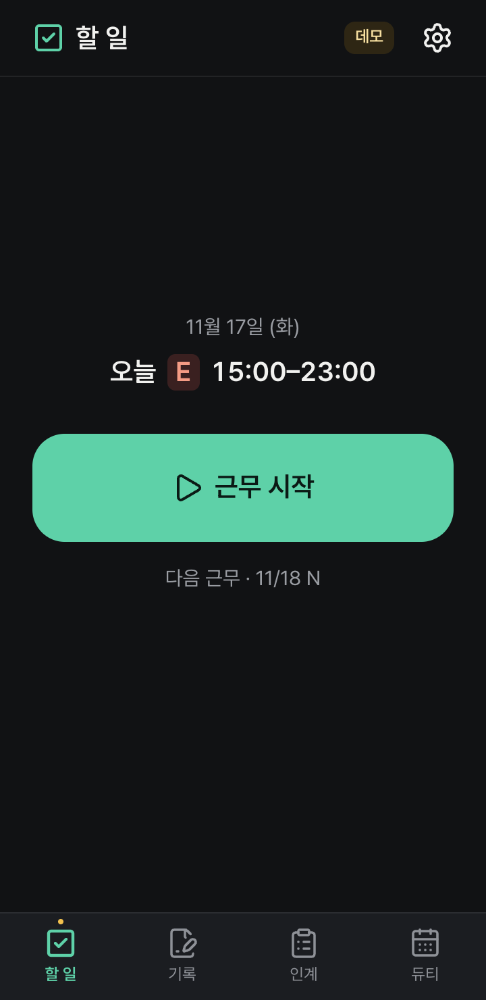<br>근무 시작</td>
    <td align="center">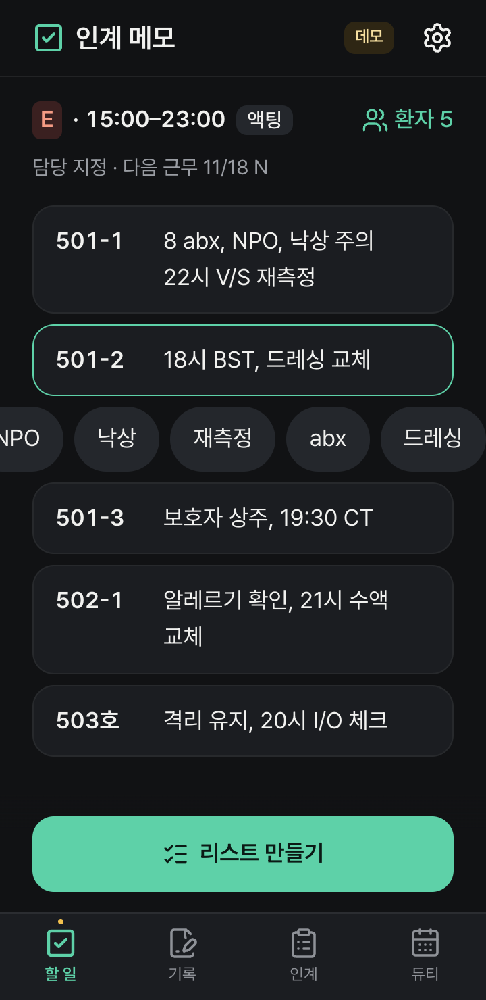<br>인계 메모</td>
    <td align="center">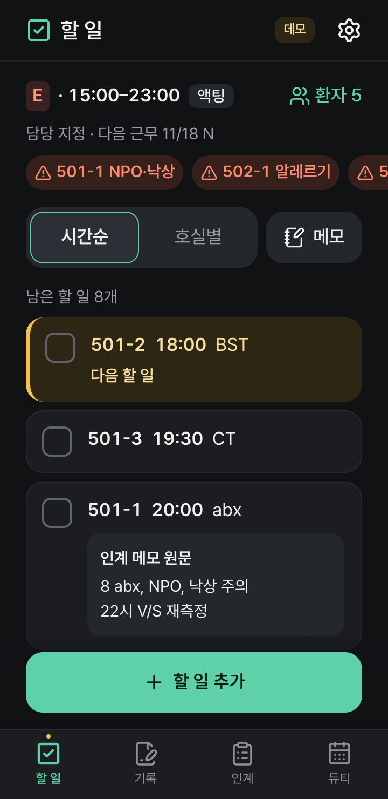<br>할 일</td>
  </tr>
  <tr>
    <td align="center">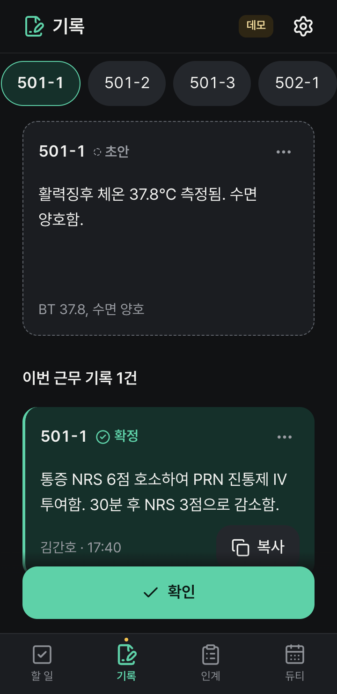<br>기록</td>
    <td align="center">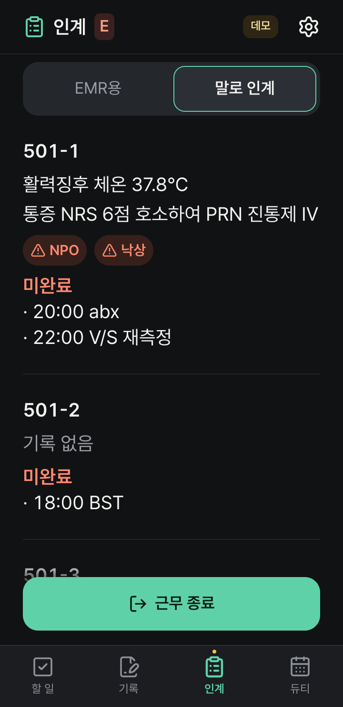<br>말로 인계</td>
    <td align="center">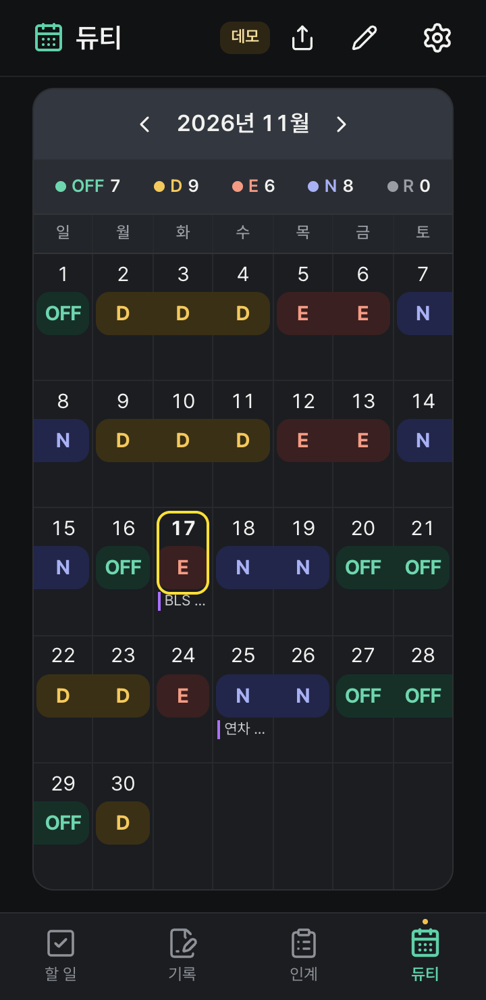<br>듀티</td>
  </tr>
</table>

**듀티 캘린더 · 일정**

<table>
  <tr>
    <td align="center">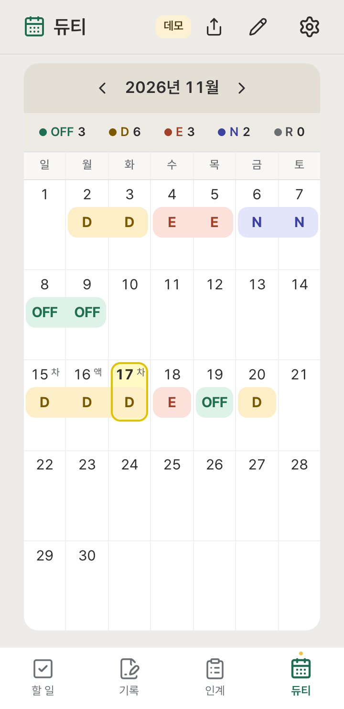<br>달력 (라이트)</td>
    <td align="center">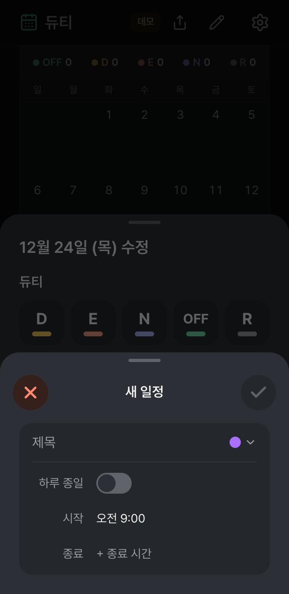<br>새 일정</td>
    <td align="center">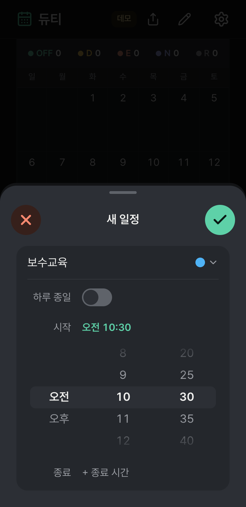<br>시간 휠</td>
  </tr>
  <tr>
    <td align="center">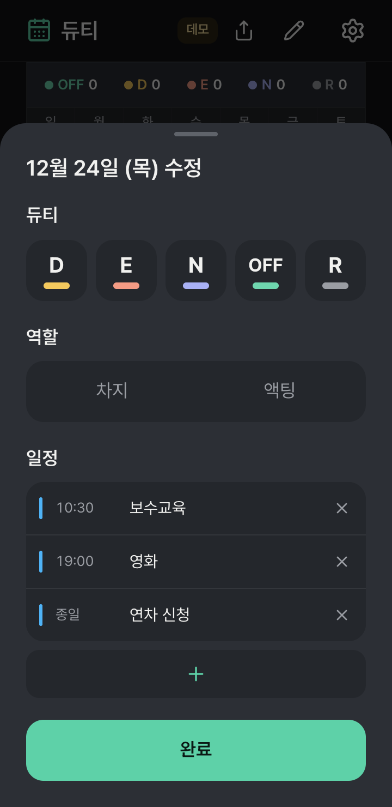<br>일정 목록</td>
    <td align="center">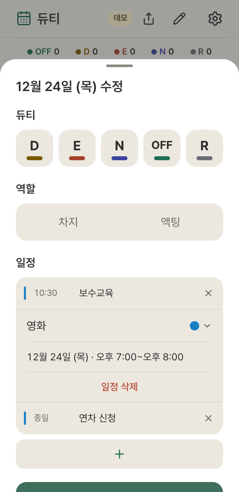<br>일정 펼침</td>
    <td align="center">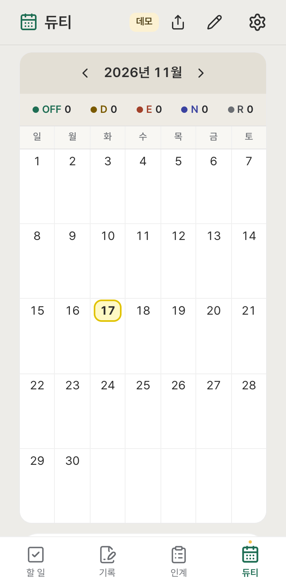<br>빈 달</td>
  </tr>
</table>

360px 다크 모드 전체 화면 11장과 글자 대비 측정 결과는 [docs/screenshots/2026-11-17/v1-dark/](docs/screenshots/2026-11-17/v1-dark/), 듀티 일정 화면(라이트·다크 18장)은 [docs/screenshots/2026-11-17/duty-events/](docs/screenshots/2026-11-17/duty-events/)에 있습니다. 같은 날짜의 `dark/`, `light/` 폴더는 구조 개편 전 화면입니다.

## 개인정보 설계

- 실명 입력 필드와 실명 대응표가 없습니다. 이전 버전의 암호화 실명 테이블은 업데이트 시 삭제됩니다.
- 외부 LLM에는 요청마다 새로 붙이는 임시 가명(`환자1`)과 비식별 필터를 통과한 문장만 보냅니다. 호실-병상은 보내지 않습니다.
- 전송 전 비식별 필터가 호실-병상, 전화번호, 주민등록번호, 날짜, 병록번호 형태, 이름 패턴을 검사하고 해당 부분을 표시합니다. 호실-병상·전화번호·주민등록번호는 사용자가 무시하더라도 가려서 보냅니다.
- 듀티 날짜 일정에 이름·전화번호·병록번호 패턴이 보이면 `환자 정보는 적지 않아요` 경고를 띄웁니다.
- 생성된 문장(기록·인계)에 근거에 없는 숫자가 있으면 확정을 막습니다.
- 모든 기록과 인계는 작성자가 `확인`해야 확정되며, 확정 전에는 복사할 수 없습니다. 확정 기록은 `⋯ > 수정`만 가능하고 수정 이력이 남습니다.

### 자동 삭제

앱을 열 때와 1시간마다 확인합니다.

| 데이터 | 삭제 시점 |
|---|---|
| 인계 메모·할 일·담당 환자 목록 | 근무 종료 12시간 후 |
| 기록 문장 | 처음 복사한 뒤 24시간 후 (복사하지 않은 기록은 근무 종료 24시간 후) |
| 인계(EMR용·말로 인계) | 근무 종료 24시간 후 |
| 듀티 캘린더·날짜 일정 | 삭제하지 않음 |

`근무 종료`를 누르지 않은 근무는 예정 종료 12시간 뒤에 예정 종료 시각으로 종료 처리되고, 다음 실행 때 상단에 `지난 근무(11/17 E)가 자동 종료됐어요`를 한 번 보여줍니다.

## 기술 스택

| 구분 | 사용 기술 |
|---|---|
| 프레임워크 | Next.js (App Router), TypeScript |
| 화면 | Tailwind CSS, Pretendard |
| 앱 형태 | PWA (홈 화면 추가, 오프라인 입력 저장) |
| 로컬 저장 | IndexedDB (Dexie) |
| 잠금 | 4자리 PIN (Web Crypto PBKDF2 해시) |
| 문장 생성 | Anthropic API (서버 API Route에서만 호출) |

## 실행 방법

```bash
npm install

# 개발 서버 (http://localhost:3000)
npm run dev

# 프로덕션 빌드 및 실행 (서비스 워커·오프라인 동작 포함)
npm run build
npm start

# 테스트 (N 근무 정렬, 자동 삭제, 실명 필드 부재, 듀티 보존, 메모 비식별 경고 등)
npm test

# 360px 화면 캡처 + 글자 대비 측정 (서버 실행 중일 때)
node scripts/capture-screens.mjs http://localhost:3000

# 듀티 날짜 시트 시나리오 점검(새 일정·휠·완료로만 저장 등) + 라이트·다크 캡처 (서버 실행 중일 때)
node scripts/duty-scenarios.mjs http://localhost:3000
```

환경변수는 `.env.example`을 `.env.local`로 복사하여 설정합니다.

| 변수 | 기본값 | 설명 |
|---|---|---|
| `ANTHROPIC_API_KEY` | 없음 | Anthropic API 키. 서버에서만 사용하며 클라이언트로 전달되지 않습니다. |
| `ANTHROPIC_MODEL` | `claude-opus-5-5` | 문장 생성에 사용할 모델 |

`ANTHROPIC_API_KEY`가 설정되지 않으면 **데모 모드**로 동작합니다. 외부 호출 없이 규칙 기반 목업 응답을 사용하며, 화면 상단에 `데모` 표시가 나타납니다.

### 데모 시나리오

1. **근무 시작**: 듀티 탭에서 오늘 날짜에 `E` 지정 → 할 일 탭 `근무 시작`(E 자동 선택) → 키패드로 `501-1~3, 503` 입력 → `인계 받기 시작`
2. **할 일**: 메모에 `8 abx, NPO, 낙상 주의` 입력 → `리스트 만들기` → 20:00 abx 할 일과 NPO·낙상 경고 칩. `보호자 상주`처럼 규칙으로 못 푼 조각은 `확인 필요`
3. **기록 확정**: 키워드 `통증 NRS 6 / PRN 진통제 IV / 30분 후 NRS 3` → `문장 만들기` → `확인` → `복사`
4. **숫자 검증 차단**: 키워드에 `#검증`을 포함하면 데모 응답이 입력에 없는 숫자를 만들고, 그 숫자를 지우기 전까지 확정이 막힙니다.
5. **비식별 차단**: 키워드에 `보호자 김철수` 또는 담당 환자 ID(`501-1`)를 넣으면 전송 전에 멈추고 해당 부분을 표시합니다.
6. **인계**: `인계 만들기` → EMR용/말로 인계 확인 → `확인` → 문단 복사 → `근무 종료`

## 폴더 구조

```text
src/
├─ app/
│  ├─ api/generate/route.ts   LLM 호출(서버 전용), 데모 모드 목업 응답
│  ├─ globals.css             디자인 토큰(색·글자·간격·듀티 색), 다크/라이트 테마
│  └─ layout.tsx              테마 초기화, 폰트, 메타데이터
├─ components/
│  ├─ App.tsx                 잠금·하단 탭 4개 전환
│  ├─ session.tsx             PIN 잠금, 설정, 자동 삭제 일정
│  ├─ PiiGuard.tsx            전송 전 비식별 검사 화면
│  ├─ RoomPicker.tsx          호실-병상 키패드·칩
│  ├─ screens/                할 일·기록·인계·듀티·설정·시작 화면
│  └─ ui/                     버튼·칩·카드·탭·세그먼트·듀티 라벨 등 공통 컴포넌트
└─ lib/
   ├─ room.ts                 호실-병상 정규화, 범위 입력, 메모 속 언급 찾기
   ├─ time.ts                 근무 시간, 모호한 시각 해석, N 근무 정렬
   ├─ taskParser.ts           인계 메모 → 할 일·경고 칩 규칙 파싱
   ├─ shift.ts                근무 시작·종료, 환자 추가·제외, 리스트 만들기
   ├─ handover.ts             EMR용 문단·말로 인계 구성, 숫자 검증
   ├─ purge.ts                자동 삭제
   ├─ deidentify.ts           비식별 필터
   ├─ numbers.ts              입력에 없는 숫자 검출
   ├─ db.ts                   IndexedDB 스키마, v1→v2 마이그레이션
   └─ llm/                    서버 프롬프트, 응답 스키마, 데모 목업
tests/                        node --test 테스트 (fake-indexeddb)
public/sw.js                  오프라인 실행용 서비스 워커
scripts/capture-screens.mjs   화면 캡처 및 글자 대비 측정
scripts/duty-scenarios.mjs    듀티 날짜 시트 시나리오 점검 및 캡처
```

## 로드맵

| 단계 | 내용 |
|---|---|
| 1단계 (현재) | EMR 독립형, 간호사 1인 단독 사용. 확정한 문장을 복사하여 EMR에 붙여넣기 |
| 2단계 | QR·바코드 리더를 통한 EMR 입력, 처방 1회 입력 후 메모·라벨 자동 배포 |
| 3단계 | 중소병원 EMR 업체 연동 모듈 |
| 4단계 | HL7 FHIR KR Core 기반 표준 출력 |

## 유의사항

- 본 서비스는 기록 작성 보조 도구이며, 진단 및 치료 판단 기능을 제공하지 않습니다.
- 생성된 문장의 최종 확인과 책임은 작성자에게 있습니다.
- 의료기관의 승인 없이 실제 환자 정보를 입력하지 마십시오. 테스트는 가상 데이터로 진행합니다.

## 라이선스

추후 결정
